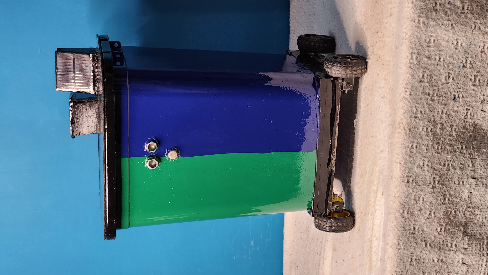
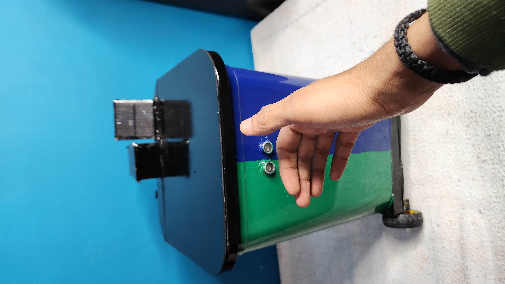
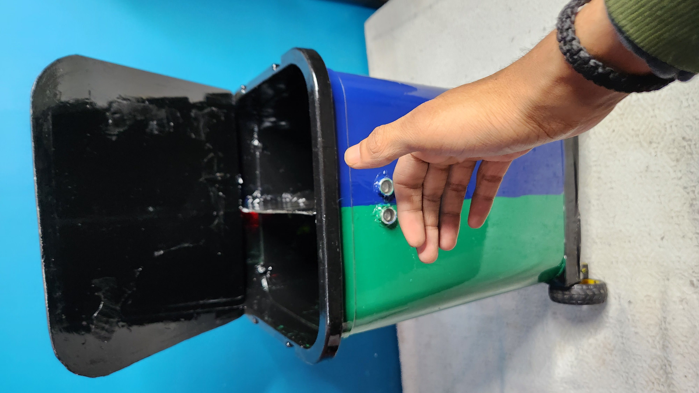
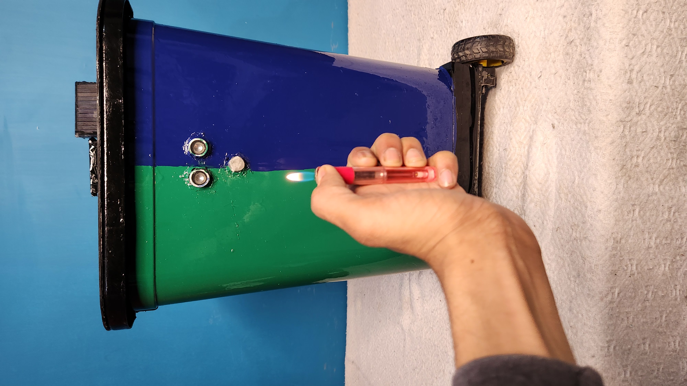
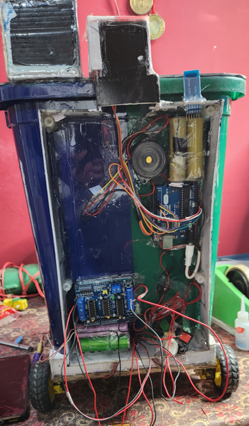
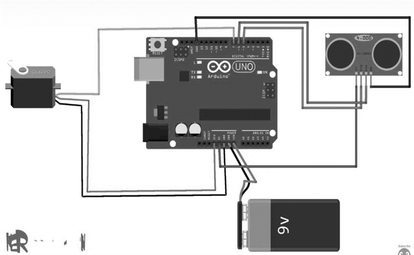
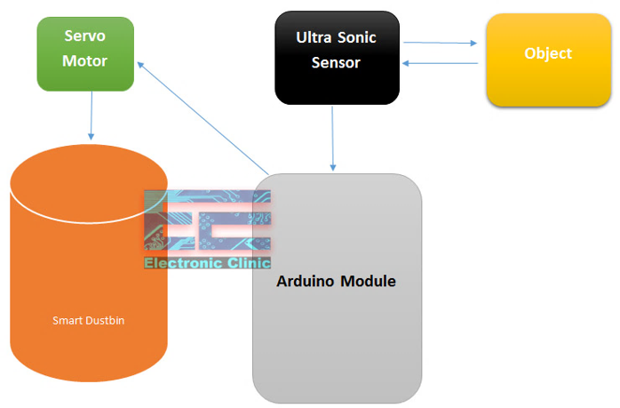
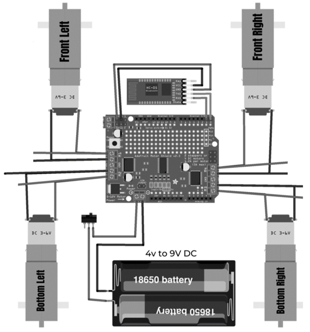
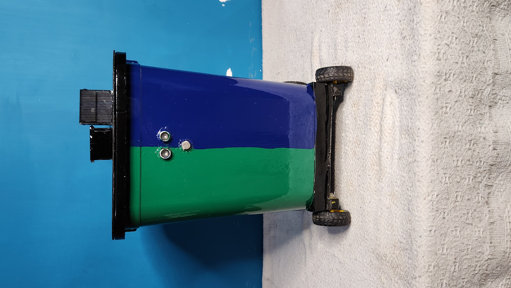
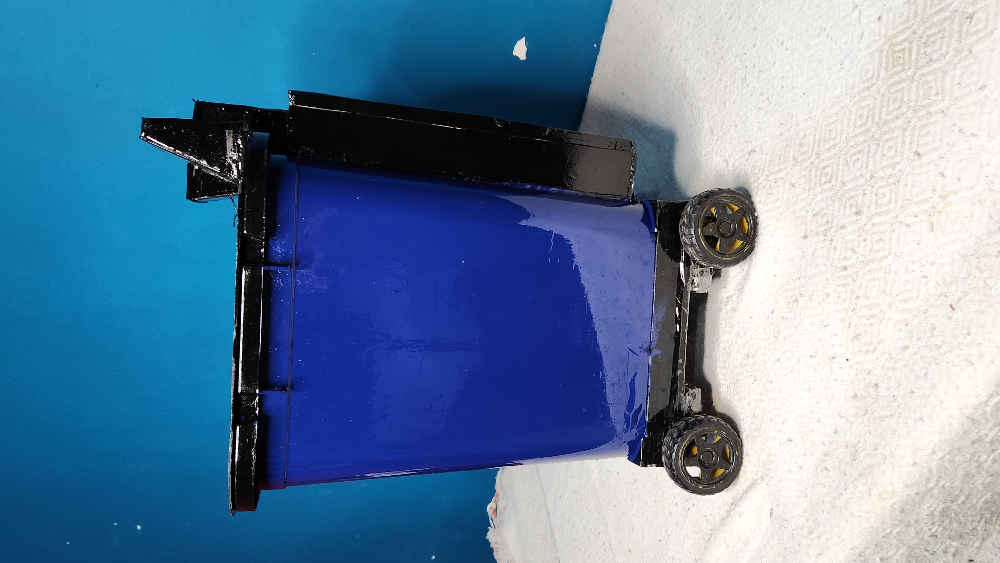

# 🗑️ Smart Dustbin

An Arduino-based multifunctional **Smart Dustbin** designed to make waste management more hygienic, convenient, and efficient.

The prototype combines **automatic lid opening, Bluetooth-controlled movement, gas/smoke detection, dual waste compartments, and a phone-controlled mopping mechanism** in a single mobile system.



---

## 📌 Project Overview

The **Smart Dustbin** is a hardware-based waste management and cleaning prototype developed by integrating Arduino, sensors, motors, Bluetooth communication, and mechanical systems.

Unlike a traditional stationary dustbin, this prototype can be moved using a smartphone and provides multiple smart features including touch-free lid opening, gas/smoke detection, separate waste compartments, and a controllable mopping mechanism.

The prototype uses **two Arduino boards** for different control operations:

- **Arduino 1:** Bluetooth-controlled movement using four geared DC motors.
- **Arduino 2:** Automatic lid operation using an ultrasonic sensor and servo motor.

The MQ-2 gas/smoke detection system operates as a separate safety circuit.

---

## ✨ Key Features

- 🤖 Automatic touch-free lid
- 📱 Smartphone-controlled movement using Bluetooth
- 🛞 Four geared DC motors for mobility
- ♻️ Two separate waste compartments
- 🚨 MQ-2 gas/smoke detection with buzzer alert
- 🧹 Phone-controlled mopping mechanism
- ⬆️⬇️ Jack-type mop lifting mechanism
- 🔋 Battery-powered prototype
- 🎮 Multiple movement directions through Bluetooth control

---

# ⚙️ How It Works

## 1. 🤖 Automatic Lid

The automatic lid system uses an **HC-SR04 ultrasonic sensor** and a **servo motor**.

When a hand or object comes within the configured detection range, the ultrasonic sensor measures the distance and sends the information to the Arduino.

The Arduino then activates the servo motor to open the lid.

After a short delay, the lid automatically closes.

### Working Flow

```text
Hand / Object
      ↓
HC-SR04 Ultrasonic Sensor
      ↓
Arduino
      ↓
Servo Motor
      ↓
Lid Opens
      ↓
Short Delay
      ↓
Lid Closes
```

### Automatic Lid in Action





---

## 2. 📱 Bluetooth-Controlled Movement

The Smart Dustbin can be moved remotely using a smartphone through an **HC-05 Bluetooth module**.

A dedicated Arduino handles the movement system.

Commands sent from the smartphone are received through Bluetooth and used to control the four geared DC motors through the motor control system.

### Supported Movements

- Forward
- Backward
- Left
- Right
- Stop
- Additional directional movements supported by the Arduino sketch

### Working Flow

```text
Smartphone
     ↓
Bluetooth Command
     ↓
HC-05 Bluetooth Module
     ↓
Arduino
     ↓
Motor Control
     ↓
4 Geared DC Motors
     ↓
Dustbin Movement
```

This allows the complete Smart Dustbin to be moved without physically carrying it.

---

## 3. 🚨 Gas / Smoke Detection

The prototype includes an **MQ-2 gas/smoke sensor** as an additional safety feature.

The MQ-2 system operates as an **independent circuit** and does not depend on the main Arduino control logic.

The circuit includes:

- MQ-2 gas/smoke sensor
- Buzzer
- Battery supply
- Switch

When smoke or detectable gas activates the sensor, the buzzer provides an audible warning.

### Working Flow

```text
Smoke / Detectable Gas
          ↓
      MQ-2 Sensor
          ↓
    Detection Circuit
          ↓
        Buzzer
          ↓
      Alert Sound
```

### Gas Detection Testing



---

## 4. ♻️ Dual Waste Compartments

The Smart Dustbin contains **two separate waste chambers**.

They are intended for:

```text
Biodegradable Waste
        +
Non-Biodegradable Waste
```

This design supports basic waste separation at the source.

> The current prototype provides separate physical compartments. It does not automatically identify or classify the type of waste.

---

## 5. 🧹 Phone-Controlled Mopping Mechanism

The Smart Dustbin also includes a **mopping mechanism mounted at the rear of the prototype**.

A **jack-type lifting mechanism** is used to move the mop up and down.

The mop position can be controlled using the smartphone.

### Working

```text
Phone Control
      ↓
Mop Control
      ↓
Jack-Type Mechanism
      ↓
Mop Moves Down / Up
```

When the assigned control is operated, the mopping mechanism can be lowered toward the floor.

When operated again, the mop can be lifted back upward.

This allows the mop to remain lifted when cleaning is not required and lowered when the user wants to perform mopping.

### Current Mopping System

In the current prototype:

- The mop can be moved up and down.
- A jack-type mechanism controls the mop position.
- The mechanism is controlled through the phone.
- The Smart Dustbin is manually driven through smartphone controls during mopping.

Therefore, the current prototype requires the user to control the movement of the Smart Dustbin while performing floor cleaning.

---

# 🔧 Hardware Components

The major hardware components used in the prototype include:

- Arduino boards
- HC-05 Bluetooth module
- HC-SR04 ultrasonic sensor
- Servo motor
- MQ-2 gas/smoke sensor
- Motor shield / motor driver
- 4 geared DC motors
- Wheels
- Buzzer
- Relay
- Switches
- Lithium-ion batteries / battery supply
- Sunboard body
- Mopping mechanism
- Jack-type mop lifting mechanism
- Connecting wires and supporting electronic components

---

# 💻 Software & Technologies

## Arduino IDE

The Arduino sketches were developed and uploaded to the Arduino boards using the **Arduino IDE**.

## Programming

The Arduino programs are written using **Arduino C/C++**.

## Arduino Libraries

The project uses libraries according to the respective subsystem, including:

```cpp
Servo.h
AFMotor.h
```

## Bluetooth Communication

The HC-05 Bluetooth module allows the Arduino movement system to receive commands from a smartphone.

---

# 🔌 Hardware Implementation

## Internal Hardware



---

## Automatic Lid Reference Circuit



---

## Automatic Lid Working Diagram



---

## Bluetooth Motor Control Reference



> **Note:** The circuit illustrations are included as reference diagrams for the implemented subsystems. The actual prototype hardware is shown in the project photographs.

---

# 💻 Arduino Code

The project uses separate Arduino sketches for the two Arduino-controlled sections.

```text
code/
│
├── bluetooth_movement/
│   └── bluetooth_movement.ino
│
└── automatic_lid/
    └── automatic_lid.ino
```

## 📱 Bluetooth Movement Code

The Bluetooth movement sketch is responsible for:

- Receiving commands from the Bluetooth module
- Controlling four motors
- Forward movement
- Backward movement
- Left movement
- Right movement
- Stop operation
- Additional supported directional movements

The sketch can be found here:

[`code/bluetooth_movement/bluetooth_movement.ino`](code/bluetooth_movement/bluetooth_movement.ino)

---

## 🤖 Automatic Lid Code

The automatic lid sketch is responsible for:

1. Reading the ultrasonic sensor.
2. Measuring the distance of a nearby object.
3. Detecting a hand/object within the configured range.
4. Controlling the servo motor.
5. Opening the lid.
6. Waiting for a short duration.
7. Closing the lid automatically.

The sketch can be found here:

[`code/automatic_lid/automatic_lid.ino`](code/automatic_lid/automatic_lid.ino)

---

# 🎥 Project Demo Videos

The following videos show the actual prototype, development process, mopping mechanism, and hardware repair work.

## ▶️ Complete Smart Dustbin Demo

A quick demonstration of the overall Smart Dustbin project and its major features.

[▶️ Watch Complete Smart Dustbin Demo](https://youtube.com/shorts/GkJoZg22r1o?feature=share)

---

## 🧹 Mopping Mechanism - Part 1

This video demonstrates the development and working of the mopping mechanism integrated into the Smart Dustbin.

[▶️ Watch Mopping Mechanism - Part 1](https://youtube.com/shorts/oHlXx1f7dsI?feature=share)

---

## 🧹 Mopping Mechanism - Part 2

This video shows another stage of the mopping mechanism and its implementation in the prototype.

[▶️ Watch Mopping Mechanism - Part 2](https://youtube.com/shorts/GZFQTbX7FqM?feature=share)

---

## 🛠️ Project Damage & Repair

Hardware prototypes can require troubleshooting and modifications during development.

This video shows part of the repair process performed on the Smart Dustbin prototype.

[▶️ Watch Project Damage & Repair](https://youtube.com/shorts/OdWkWCG0n1o?feature=share)

---

> 🎬 These videos show different stages of the actual prototype, including its working, development, mopping mechanism, and hardware troubleshooting.

---

# 📸 Project Gallery

## Front View



---

## Angle View


---

## Side View



---

# 📄 Project Report

A detailed project report containing the project architecture, components, working principles, implementation, testing, results, and future improvements is available in this repository.

### 📥 View Project Report

[📄 Smart Dustbin Professional Project Report](docs/Smart-Dustbin-Project-Report.pdf)

---

# 📁 Project Structure

```text
Smart-Dustbin/
│
├── code/
│   │
│   ├── bluetooth_movement/
│   │   └── bluetooth_movement.ino
│   │
│   └── automatic_lid/
│       └── automatic_lid.ino
│
├── images/
│   ├── smart-dustbin-front-view.jpg
│   ├── smart-dustbin-angle-view.jpg
│   ├── smart-dustbin-side-view.jpg
│   ├── automatic-lid-detection.jpg
│   ├── automatic-lid-open.jpg
│   ├── gas-detection-testing.jpg
│   ├── smart-dustbin-hardware.png
│   ├── automatic-lid-circuit.png
│   ├── automatic-lid-working.png
│   └── bluetooth-motor-circuit.png
│
├── docs/
│   └── Smart-Dustbin-Project-Report.pdf
│
└── README.md
```

---

# 🚀 Future Upgrades

The future version of the Smart Dustbin is planned to evolve from a manually controlled mobile prototype into an **autonomous waste-management and floor-cleaning system**.

## 🌪️ Vacuum Cleaning

A **vacuum-cleaning mechanism** is planned to be added to the Smart Dustbin.

The vacuum system would allow the machine to collect dust and small debris from the floor while moving.

---

## 🧹 Automatic Mopping

Currently, the mopping mechanism can be lowered and lifted using the phone, while the movement of the Smart Dustbin during mopping is manually controlled by the user.

In the future, the existing mopping mechanism can be integrated with autonomous navigation.

This would allow the system to perform mopping automatically without requiring continuous movement commands from the user.

---

## 🌪️ + 🧹 Vacuum and Mopping System

One of the major planned upgrades is to combine **vacuum cleaning and automatic mopping**.

```text
Autonomous Movement
        ↓
Obstacle Detection
        ↓
Vacuum Cleaning
        +
Automatic Mopping
        ↓
Complete Floor Cleaning
```

The Smart Dustbin could therefore perform two major functions:

```text
Waste Management
       +
Floor Cleaning
```

This would transform the prototype into a **multipurpose autonomous cleaning and waste-management system**.

---

## 🤖 Autonomous Navigation

The current prototype is moved manually using smartphone controls.

In the future, additional sensors and navigation logic can be integrated so that the system can:

- Move automatically
- Detect obstacles
- Avoid collisions
- Navigate around a room
- Perform cleaning automatically
- Reduce continuous manual control

---

## 📏 Bin Fill-Level Detection

Sensors can be added inside the waste compartments to detect the amount of waste.

The system could then indicate when a compartment needs to be emptied.

---

## 🔋 Battery Monitoring

A battery-monitoring system can be added to display the remaining battery level.

Improved charging and power-management circuitry can also be integrated.

---

## 📱 Dedicated Mobile Application

A dedicated mobile application can be developed to provide:

- Movement controls
- Mop up/down controls
- Cleaning mode
- Vacuum control
- Battery information
- Bin status
- System controls

---

## ♻️ Advanced Waste Classification

Suitable sensors and control logic can be explored in future versions to identify different types of waste and provide more advanced waste classification.

---

# 🎯 Project Outcome

The **Smart Dustbin** prototype demonstrates how Arduino, sensors, motors, Bluetooth communication, electronics, and mechanical systems can be integrated into a practical waste-management solution.

The project combines:

**Waste Management + Mobility + Touch-Free Operation + Gas/Smoke Detection + Mopping**

The future objective is to further develop the prototype into an autonomous system capable of:

**Waste Management + Vacuum Cleaning + Automatic Mopping**

---

# 👨‍💻 Project By

**Akshit Aggarwal**

Arduino & Embedded Systems Project